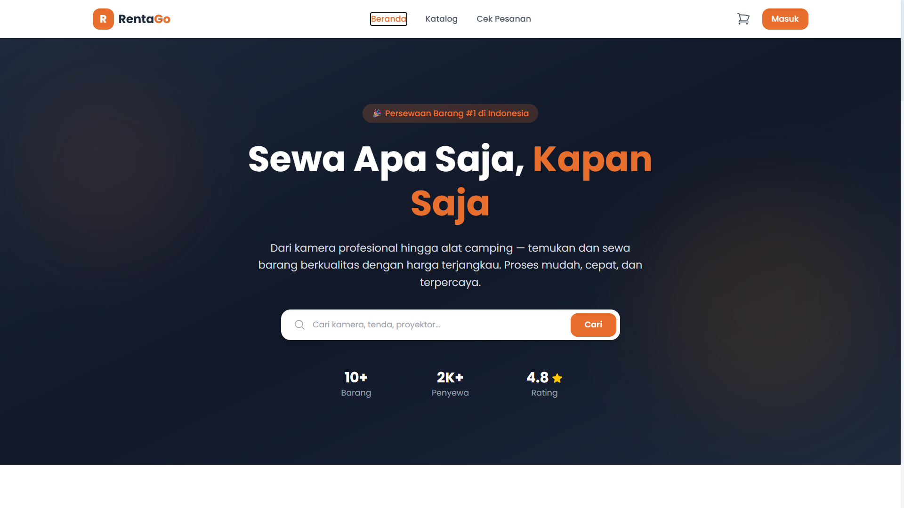
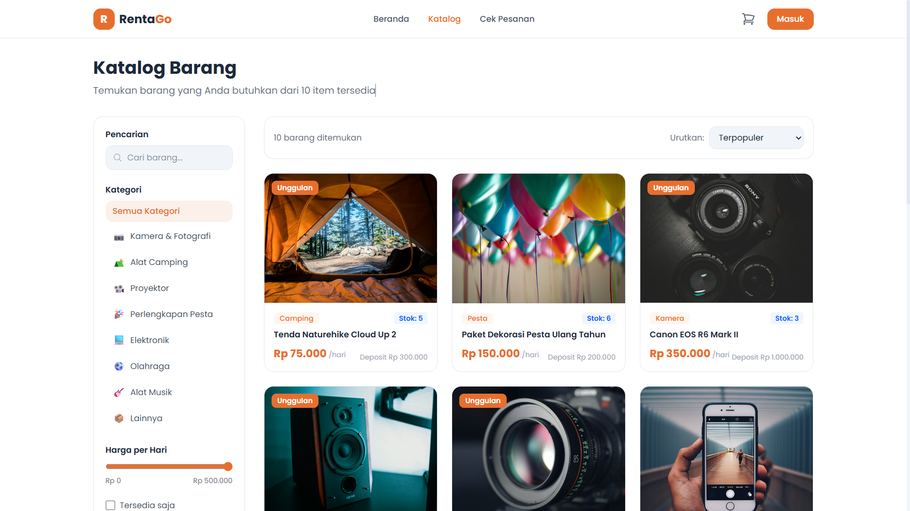
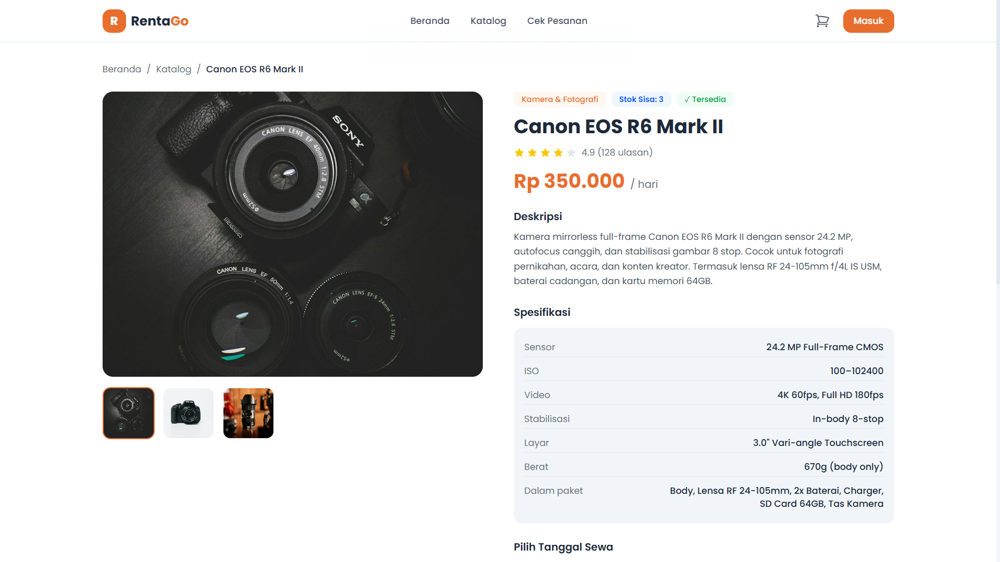
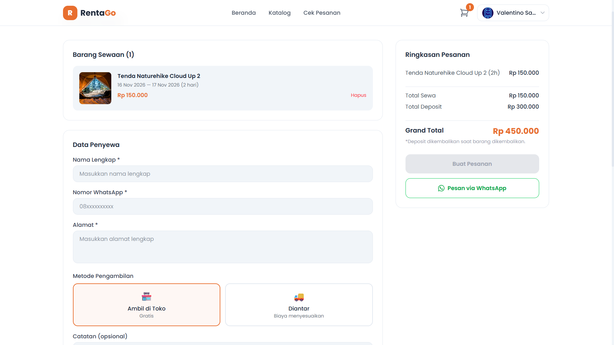
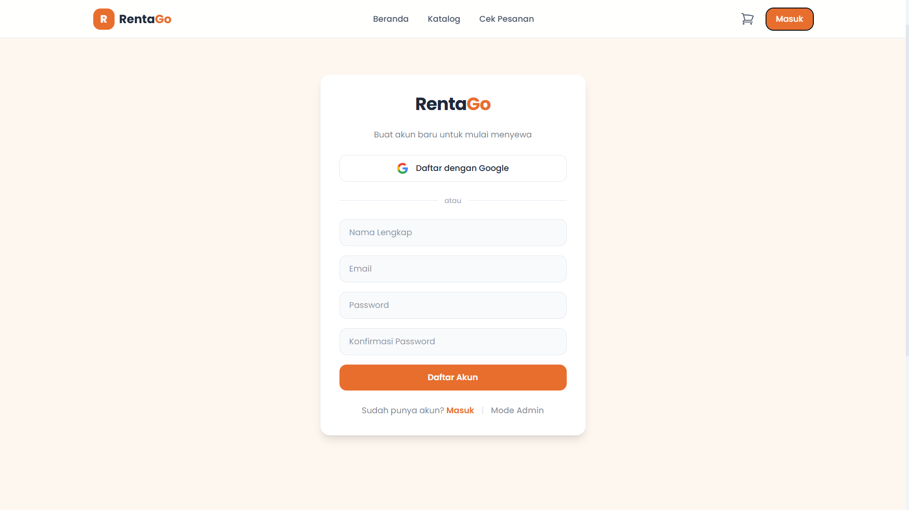
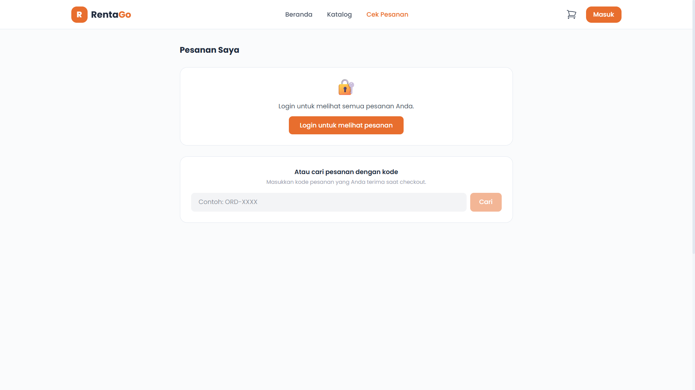
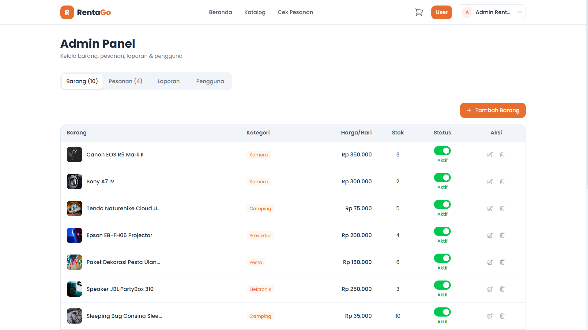
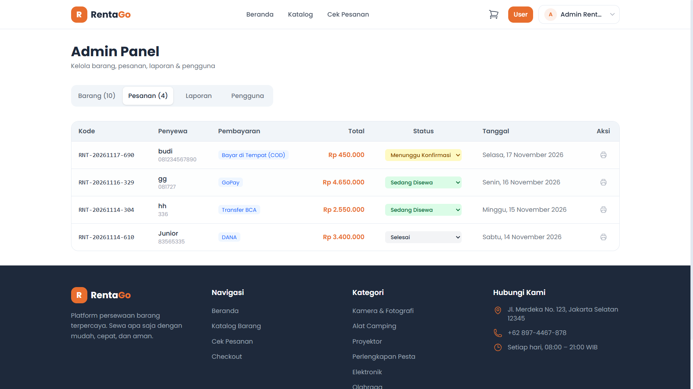

# 🎯 RentaGo — Aplikasi Persewaan Barang

Aplikasi web persewaan barang berbasis **Next.js 16** + **Supabase** + **Tailwind CSS 4**. Mendukung katalog barang, keranjang, checkout, tracking pesanan, dan panel admin lengkap.

---

## 📸 Screenshots

### Halaman Utama (Hero)


### Katalog Barang


### Detail Barang


### Checkout


### Halaman Login / Daftar


### Cek Pesanan


### Admin Panel — Kelola Barang


### Admin Panel — Kelola Pesanan


---

## ✨ Fitur

### User
- 🔍 Pencarian & filter barang (kategori, harga, ketersediaan)
- 📅 Pemilihan tanggal sewa dengan cek konflik booking
- 🛒 Keranjang belanja
- 📝 Checkout dengan form pelanggan, pilihan pengiriman, & metode pembayaran
- 📦 Tracking status pesanan (Shopee-style timeline)
- 🔑 Login via Email/OTP & Google OAuth
- 🔒 Reset password via email

### Admin
- 📊 Dashboard dengan 4 tab: Barang, Pesanan, Laporan, Pengguna
- ➕ CRUD barang (nama, kategori, harga, deposit, stok, gambar, spesifikasi)
- 📋 Manajemen pesanan (update status, cetak nota)
- 📈 Laporan pendapatan (export Word/print)
- 👥 Daftar pengguna terdaftar

---

## 🛠️ Tech Stack

| Layer | Teknologi |
|-------|-----------|
| Framework | Next.js 16 (App Router) |
| UI | Tailwind CSS 4, React 19 |
| Backend/DB | Supabase (PostgreSQL + Auth + Storage) |
| Auth | Supabase Auth (Email OTP, Google OAuth) |
| Language | TypeScript |

---

## 🚀 Cara Menjalankan

### 1. Clone & Install

```bash
git clone <repo-url>
cd rental-app
npm install
```

### 2. Setup Supabase

1. Buat project baru di [supabase.com](https://supabase.com)
2. Copy **Project URL** dan **anon key** dari Settings → API
3. Buat file `.env.local`:

```env
NEXT_PUBLIC_SUPABASE_URL=https://xxxxx.supabase.co
NEXT_PUBLIC_SUPABASE_ANON_KEY=eyJhbGci...
```

### 3. Setup Database

Buka **SQL Editor** di Supabase Dashboard, lalu jalankan isi file `supabase-schema.sql`.

### 4. Jalankan

```bash
npm run dev
```

Buka [http://localhost:3000](http://localhost:3000)

---

## 🗄️ Database Schema (Supabase / PostgreSQL)

### Entity Relationship

```
┌──────────────┐       ┌──────────────────┐       ┌──────────────┐
│  auth.users  │       │     profiles     │       │    items     │
│──────────────│       │──────────────────│       │──────────────│
│ id (uuid) PK │──1:1──│ id (uuid) PK/FK  │       │ id (uuid) PK │
│ email        │       │ name             │       │ slug (unique)│
│ ...          │       │ email            │       │ name         │
└──────────────┘       │ avatar_url       │       │ category     │
                       │ role             │       │ description  │
                       │ created_at       │       │ specifications│
                       └──────────────────┘       │ price_per_day│
                              │                   │ deposit      │
                              │                   │ images[]     │
                              │ 1:N               │ stock        │
                              │                   │ rating       │
                       ┌──────┴───────────┐       │ review_count │
                       │     orders       │       │ featured     │
                       │──────────────────│       │ available    │
                       │ id (uuid) PK     │       │ booked_dates[]│
                       │ code (unique)    │       │ created_at   │
                       │ user_id (FK)─────│       └──────────────┘
                       │ items (jsonb)    │
                       │ total_price      │
                       │ total_deposit    │
                       │ grand_total      │
                       │ customer_name    │
                       │ customer_whatsapp│
                       │ customer_address │
                       │ customer_id_number│
                       │ delivery_method  │
                       │ payment_method   │
                       │ status           │
                       │ notes            │
                       │ created_at       │
                       └──────────────────┘
```

### Tabel `profiles`

| Kolom | Tipe | Constraint | Keterangan |
|-------|------|------------|------------|
| `id` | `uuid` | PK, FK → `auth.users(id)` ON DELETE CASCADE | ID user dari Supabase Auth |
| `name` | `text` | — | Nama lengkap |
| `email` | `text` | — | Email |
| `avatar_url` | `text` | — | URL foto profil |
| `role` | `text` | DEFAULT `'user'`, CHECK `('user', 'admin')` | Role pengguna |
| `created_at` | `timestamptz` | DEFAULT `now()` | Waktu dibuat |

**RLS Policies:**
- `Public profiles readable` — SELECT untuk semua
- `Users can update own profile` — UPDATE hanya `auth.uid() = id`
- `Users can insert own profile` — INSERT hanya `auth.uid() = id`

**Trigger:** `on_auth_user_created` → otomatis buat row profile saat user signup via fungsi `handle_new_user()`.

---

### Tabel `items`

| Kolom | Tipe | Constraint | Keterangan |
|-------|------|------------|------------|
| `id` | `uuid` | PK, DEFAULT `gen_random_uuid()` | ID barang |
| `slug` | `text` | UNIQUE, NOT NULL | URL slug |
| `name` | `text` | NOT NULL | Nama barang |
| `category` | `text` | NOT NULL | Kategori (`kamera`, `camping`, `proyektor`, `pesta`, `elektronik`, `olahraga`, `musik`, `lainnya`) |
| `description` | `text` | — | Deskripsi barang |
| `specifications` | `jsonb` | DEFAULT `'{}'` | Spesifikasi (key-value) |
| `price_per_day` | `integer` | NOT NULL | Harga sewa per hari (Rp) |
| `deposit` | `integer` | NOT NULL | Deposit (Rp) |
| `images` | `text[]` | DEFAULT `'{}'` | Array URL gambar |
| `stock` | `integer` | DEFAULT `1` | Jumlah stok |
| `rating` | `numeric(3,2)` | DEFAULT `0` | Rating rata-rata |
| `review_count` | `integer` | DEFAULT `0` | Jumlah review |
| `featured` | `boolean` | DEFAULT `false` | Tampil di halaman utama |
| `available` | `boolean` | DEFAULT `true` | Status ketersediaan |
| `booked_dates` | `text[]` | DEFAULT `'{}'` | Tanggal-tanggal yang sudah dibooking (`YYYY-MM-DD`) |
| `created_at` | `timestamptz` | DEFAULT `now()` | Waktu dibuat |

**RLS Policies:**
- `Items readable by all` — SELECT untuk semua
- `Admin can insert items` — INSERT hanya role `admin`
- `Admin can update items` — UPDATE hanya role `admin`
- `Admin can delete items` — DELETE hanya role `admin`

---

### Tabel `orders`

| Kolom | Tipe | Constraint | Keterangan |
|-------|------|------------|------------|
| `id` | `uuid` | PK, DEFAULT `gen_random_uuid()` | ID pesanan |
| `code` | `text` | UNIQUE, NOT NULL | Kode pesanan (format: `RNT-YYYYMMDD-XXX`) |
| `user_id` | `uuid` | FK → `profiles(id)` | ID pemesan |
| `items` | `jsonb` | NOT NULL, DEFAULT `'[]'` | Data barang yang dipesan |
| `total_price` | `integer` | NOT NULL | Total harga sewa (Rp) |
| `total_deposit` | `integer` | NOT NULL | Total deposit (Rp) |
| `grand_total` | `integer` | NOT NULL | Grand total (Rp) |
| `customer_name` | `text` | NOT NULL | Nama pelanggan |
| `customer_whatsapp` | `text` | NOT NULL | Nomor WhatsApp |
| `customer_address` | `text` | NOT NULL | Alamat pelanggan |
| `customer_id_number` | `text` | — | Nomor KTP |
| `delivery_method` | `text` | NOT NULL, CHECK `('pickup', 'delivery')` | Metode pengiriman |
| `payment_method` | `text` | NOT NULL | Metode pembayaran |
| `status` | `text` | DEFAULT `'pending'`, CHECK `('pending', 'confirmed', 'active', 'returned', 'completed', 'cancelled')` | Status pesanan |
| `notes` | `text` | — | Catatan tambahan |
| `created_at` | `timestamptz` | DEFAULT `now()` | Waktu dibuat |

**RLS Policies:**
- `Users can view own orders` — SELECT jika `auth.uid() = user_id` atau role `admin`
- `Users can insert orders` — INSERT jika `auth.uid() = user_id`
- `Admin can update orders` — UPDATE hanya role `admin`
- `Anyone can search by code` — SELECT untuk semua (lookup pesanan by code untuk guest)

---

### Status Pesanan (Order Flow)

```
pending ──→ confirmed ──→ active ──→ returned ──→ completed
   │                                                  
   └──────────────→ cancelled                         
```

| Status | Label | Keterangan |
|--------|-------|------------|
| `pending` | Menunggu Konfirmasi | Pesanan baru masuk |
| `confirmed` | Dikonfirmasi | Admin sudah konfirmasi |
| `active` | Sedang Disewa | Barang sedang dipakai |
| `returned` | Dikembalikan | Barang sudah dikembalikan |
| `completed` | Selesai | Transaksi selesai |
| `cancelled` | Dibatalkan | Pesanan dibatalkan |

---

### Kategori Barang

| Key | Label | Icon |
|-----|-------|------|
| `kamera` | Kamera & Fotografi | 📷 |
| `camping` | Alat Camping | ⛺ |
| `proyektor` | Proyektor | 📽️ |
| `pesta` | Perlengkapan Pesta | 🎉 |
| `elektronik` | Elektronik | 💻 |
| `olahraga` | Olahraga | ⚽ |
| `musik` | Alat Musik | 🎸 |
| `lainnya` | Lainnya | 📦 |

---

### Metode Pembayaran

| Kategori | Metode |
|----------|--------|
| Transfer Bank | BCA, BRI, Mandiri, BNI |
| E-Wallet | DANA, OVO, GoPay, ShopeePay |
| Lainnya | Bayar di Tempat (COD) |

---

## 📁 Struktur Project

```
rental-app/
├── src/
│   ├── app/
│   │   ├── admin/              # Panel admin (CRUD barang, pesanan, laporan, pengguna)
│   │   ├── auth/callback/      # OAuth callback handler
│   │   ├── barang/             # Katalog & detail barang
│   │   │   └── [slug]/         # Detail barang per slug
│   │   ├── checkout/           # Halaman checkout
│   │   ├── login/              # Login, register, OTP, reset password
│   │   ├── pesanan/            # Tracking pesanan
│   │   ├── layout.tsx          # Root layout (providers, navbar, footer)
│   │   ├── page.tsx            # Homepage
│   │   └── not-found.tsx       # 404 page
│   ├── components/
│   │   ├── Navbar.tsx          # Navigasi utama
│   │   ├── Footer.tsx          # Footer
│   │   ├── FeaturedItems.tsx   # Barang unggulan di homepage
│   │   ├── HeroSearch.tsx      # Search bar di hero section
│   │   ├── HomeStats.tsx       # Statistik di homepage
│   │   ├── ItemCard.tsx        # Kartu barang
│   │   ├── DateRangePicker.tsx # Picker tanggal sewa
│   │   └── PriceSummary.tsx    # Ringkasan harga
│   ├── data/
│   │   ├── items.ts            # Seed data barang
│   │   └── orders.ts           # Seed data pesanan
│   └── lib/
│       ├── auth-context.tsx    # Auth provider (Supabase Auth)
│       ├── cart-context.tsx    # Cart state management
│       ├── store-context.tsx   # Global store (items + orders dari Supabase)
│       ├── supabase.ts        # Supabase browser client
│       ├── supabase-server.ts # Supabase server client
│       ├── types.ts           # TypeScript types & constants
│       └── utils.ts           # Utility functions
├── supabase-schema.sql         # SQL schema utama
├── fix-signup.sql              # Fix signup error
├── fix-trigger.sql             # Fix trigger handle_new_user
├── .env.local                  # Environment variables (Supabase credentials)
└── package.json
```

---

## 🔐 Authentication

| Metode | Keterangan |
|--------|------------|
| Email + OTP | Daftar via email, verifikasi kode OTP yang dikirim ke inbox |
| Google OAuth | Login/daftar satu klik via akun Google |
| Reset Password | Kirim link reset ke email, update password langsung di app |

### Setup Google OAuth
1. Buka Supabase Dashboard → Authentication → Providers
2. Enable Google
3. Masukkan Client ID & Secret dari Google Cloud Console
4. Set redirect URL: `https://<project-ref>.supabase.co/auth/v1/callback`

---


---

## 📜 SQL Files

| File | Fungsi |
|------|--------|
| `supabase-schema.sql` | Schema lengkap (tabel, RLS, trigger) — jalankan pertama kali |
| `fix-signup.sql` | Fix error "Database error saving new user" |
| `fix-trigger.sql` | Fix trigger `handle_new_user` agar signup tidak gagal |

---

## License

MIT
